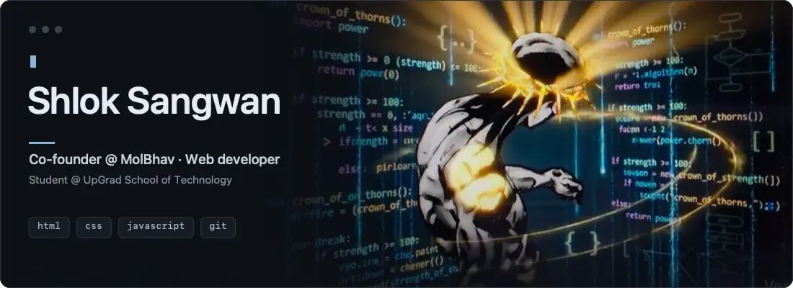

   

  

## ✦ About me

I'm **Shlok Sangwan**, a student at **UpGrad School of Technology**. I'm the co-founder of **[MolBhav](https://molbhav-gamma.vercel.app)**, a Pune startup that forecasts mandi prices for restaurants and cloud kitchens.

I care about clear communication, solving problems step by step, and getting better at Git and the web every week.

- 🔭 **Co-founding:** MolBhav with Arjun Malik
- 🌱 **Learning:** web development, Git and GitHub
- ⚽ **Outside code:** reading, playing sports and watching movies
- 🤝 **Open to:** team projects and hackathons

## 🛠️ Tech stack

  

**Languages:** `HTML` · `CSS` · `JavaScript`  
**Tools:** `Git` · `GitHub` · `GitHub Pages`  
**Strengths:** `Communication` · `Problem solving` · `Teamwork`

## 📂 Featured projects

<table>
<tr>
<td width="50%" valign="top" align="center"> <a href="https://github.com/shloksangwan/molbhav-mvp"><b>Repository ↗</b></a> · <a href="https://molbhav-gamma.vercel.app"><b>Live site ↗</b></a></td>
<td width="50%" valign="top" align="center"> <a href="https://arj052.github.io/levity-energy-/"><b>Live site ↗</b></a> · <a href="https://github.com/Arj052/levity-energy-"><b>Repository ↗</b></a></td>
</tr>
<tr>
<td width="50%" valign="top" align="center"> <a href="https://arj052.github.io/Awasars/"><b>Live site ↗</b></a> · <a href="https://github.com/Arj052/Awasars"><b>Repository ↗</b></a></td>
<td width="50%" valign="top" align="center"> <a href="https://shloksangwan.github.io/Git-Project-shlok/"><b>Live site ↗</b></a> · <a href="https://github.com/shloksangwan/Git-Project-shlok"><b>Repository ↗</b></a></td>
</tr>
</table>

<b>✦ MolBhav — features & highlights</b>

 

- Real wholesale prices for tomato, onion and potato from AGMARKNET (data.gov.in), across Pune mandis
- TradingView-style live chart, 3 months of history and a 14-day estimate with a buy / wait / steady signal
- Google sign-in, a business-details step and a personal dashboard
- Private admin panel with a live login counter, search and CSV export
- Express + libSQL on Vercel (Mumbai region) with a Turso database; Motion scroll story and per-vegetable colour themes

<b>✦ Levity Energy — features & highlights</b>

 

- 3D, floating-style product showcase with interactive depth effects
- Spinnable, flavour-reactive can and scroll-driven transitions
- Working product showcase and purchase flow
- Hosted on GitHub Pages

<b>✦ Awasars — features & highlights</b>

 

- Bridges the gap between education and employment for young people
- Internships, mentorship and career opportunities in one place
- Hosted on GitHub Pages

<b>✦ About-me page — features & highlights</b>

 

- Built while learning Git and GitHub at UpGrad School of Technology
- About me, skills, projects and hobbies
- Published with GitHub Pages

## 🤝 Let's connect

  

Levity Energy and Awasars are team projects hosted on Arjun Malik’s GitHub.

